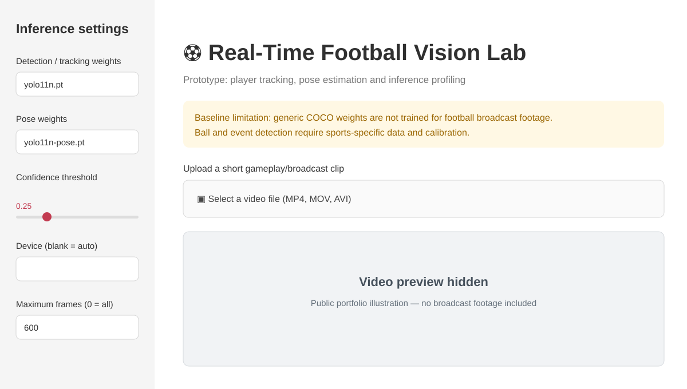

# Real-Time Football Event Detection & Pose Estimation

A prototype computer-vision pipeline for analysing football video-game broadcast footage. The first milestone provides video ingestion, player tracking, human pose overlays, annotated-video export and inference profiling.

> **Status:** Stage 1 prototype. This is an engineering prototype, not a validated goal/shot detector. Generic COCO weights are not specialised for small footballs, broadcast overlays or game-specific UI elements.

## Project scope

This KTP-oriented prototype explores real-time computer vision for football broadcast analysis. Stage 1 establishes the video-processing foundation; it does not yet claim validated match-event recognition. The initial demonstrator can be exercised with football gameplay footage while the later work will target real broadcast footage and sport-specific datasets.

## Stage 1 dashboard

The dashboard layout is shown below. The public illustration intentionally omits the original broadcast preview; use footage you are licensed to share when reproducing the demonstration.



## Features

- Video upload and processing through a Streamlit interface
- Ultralytics YOLO tracking with ByteTrack persistence
- Human pose estimation overlays
- Annotated MP4 export
- Per-frame inference time and average throughput metrics
- Modular event-detector scaffold for future temporal logic

## Architecture

`Video → OpenCV → YOLO tracking → Pose estimation → Annotated video + metrics → Streamlit`

## Quick start

Python 3.10–3.12 is recommended.

```bash
git clone https://github.com/kunal190399/realtime-football-vision.git
cd realtime-football-vision
python -m venv .venv
source .venv/bin/activate       # Windows: .venv\\Scripts\\activate
python -m pip install --upgrade pip
pip install -r requirements.txt
streamlit run app/dashboard.py
```

The first run downloads the configured model weights. For GPU inference, install a PyTorch build compatible with your CUDA environment and verify that Ultralytics can access the GPU. Leave the device field blank for automatic selection.

## Current limitations

1. COCO-pretrained YOLO detects people but does not provide a reliable, dedicated football detector for broadcast footage.
2. Broadcast overlays, camera cuts, miniature players and stylised game graphics can differ substantially from natural-image training data.
3. Goal, shot and possession events are not yet implemented. These require a sports-specific ball/player detector, temporal tracking and usually scoreboard/goal-region calibration.
4. Reported FPS is model inference throughput and excludes some I/O and UI overhead. Results depend on hardware, model size, resolution and video codec.

## Roadmap

- [x] Stage 1 scaffold: video ingestion, tracking, pose overlay and metrics
- [ ] Add sports-specific player/ball dataset and detector training
- [ ] Add temporal ball tracking and possession estimation
- [ ] Add calibrated shot/goal candidate detection and event evaluation
- [ ] Add mAP, precision-recall, event F1 and latency benchmark reports
- [ ] Add demo clips and reproducible experiment configuration

## Responsible use and data

Use footage and datasets you have permission to process and redistribute. Do not commit copyrighted match footage or model weights unless their licences permit redistribution. Record dataset provenance and licences before training.

## License

MIT. See `LICENSE`.
